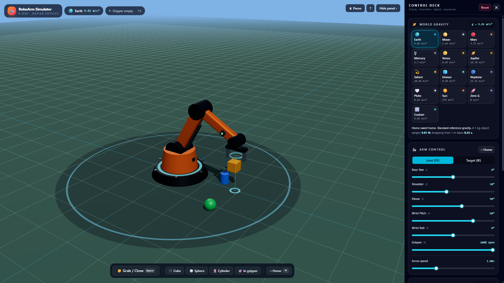

# 🦾 RoboArm Simulator — 6-DOF Robotic Arm

<p align="center">
  
</p>

<p align="center">
  <strong>An Interactive 3D Robotic Arm Simulator Powered by Three.js & Rapier Physics</strong>
</p>

<p align="center">
  
  
  
  
  
</p>

---

## 🚀 Overview

**RoboArm Simulator** is an interactive, browser-based 3D robotic arm simulation environment designed to demonstrate robotic manipulation, kinematics, and real-time physics.

Featuring a 6-Degree-of-Freedom (6-DOF) robotic arm with an interactive gripper, the simulator allows users to control individual joints, manipulate objects, experiment with different gravitational environments, and create automated movement sequences.

Built with **React, Three.js, React Three Fiber, and Rapier Physics**, this project provides an engaging virtual environment for exploring robotics and engineering concepts.

## ✨ Features

### 🦾 Robotic Arm Control
- Interactive 6-DOF robotic arm.
- Individual joint control using sliders.
- Adjustable servo movement speed.
- Configurable wrist pitch and roll.
- Reset to home position.

### 🎯 Kinematics
- Forward Kinematics (FK) control mode.
- Inverse Kinematics (IK) control mode.
- Interactive target positioning.
- Real-time end-effector positioning.

### 🌍 Physics Simulation
- Real-time Rapier physics engine.
- Multiple planetary gravity presets.
- Custom gravity configuration.
- Zero-gravity simulation.
- Physics-based object interaction.

### ✋ Object Manipulation
- Interactive robotic gripper.
- Grab and release objects.
- Spawn cubes, spheres, and cylinders.
- Spawn objects inside the gripper.
- Select and remove simulation objects.
- Adjustable object size.

### 🎬 Motion Sequences
- Create and record movement waypoints.
- Play automated movement sequences.
- Stop sequence playback.
- Loop movement sequences.

### 📊 Simulation Monitoring
- Real-time end-effector coordinates.
- Object interaction statistics.
- Grab and release counters.
- Spawned object statistics.
- Simulation activity logs.

### 🎮 User Interface
- Modern dark-themed dashboard.
- Interactive 3D environment.
- Real-time camera controls.
- Pause and resume simulation.
- Responsive control panels.
- Keyboard shortcuts.

## 🖥️ Preview

<p align="center">
  
</p>

## 🛠️ Technology Stack

| Technology | Purpose |
|---|---|
| React 19 | User Interface |
| TypeScript | Type-safe development |
| Three.js | 3D rendering |
| React Three Fiber | React-based 3D rendering |
| React Three Drei | 3D utilities and controls |
| Rapier Physics | Physics simulation |
| Zustand | State management |
| Tailwind CSS 4 | UI styling |
| Vite 7 | Development and build tooling |

## 📦 Installation

### Prerequisites

- Node.js (LTS recommended)
- npm
- Git
- Modern web browser with WebGL support

### 1. Clone the Repository

```bash
git clone https://github.com/haisam10/RoboArm-Simulator-6-DOF.git
```

### 2. Navigate to the Project

```bash
cd RoboArm-Simulator-6-DOF
```

### 3. Install Dependencies

```bash
npm install
```

### 4. Start the Development Server

```bash
npm run dev
```

### 5. Open in Browser

Visit the local URL provided by Vite:

```text
http://localhost:5173
```

## 🎮 Controls & Interaction

| Control | Action |
|---|---|
| Q / E | Rotate the base |
| W / S | Control shoulder movement |
| A / D | Control elbow movement |
| R / F | Adjust wrist movement |
| Space | Grab or release objects |
| H | Return to home position |
| B | Spawn an object inside the gripper |
| Mouse Drag | Rotate the 3D camera |
| Mouse Scroll | Zoom in and out |
| Sliders | Adjust joints and simulation parameters |

*Note: Keyboard shortcuts are based on the simulator's configured controls.*

## 🌌 Gravity Environments

Explore different gravitational environments and observe how objects behave under different physical conditions.

Available presets:

- Earth
- Moon
- Mars
- Mercury
- Venus
- Jupiter
- Saturn
- Uranus
- Neptune
- Pluto
- Sun
- Zero Gravity
- Custom Gravity

## 📂 Project Structure

```text
RoboArm-Simulator-6-DOF/
│
├── public/
│
├── src/
│   ├── lib/
│   │   ├── arm.ts
│   │   ├── planets.ts
│   │   └── shared.ts
│   │
│   ├── scene/
│   │   ├── RobotArm.tsx
│   │   ├── Scene.tsx
│   │   ├── SimObjects.tsx
│   │   └── World.tsx
│   │
│   ├── ui/
│   │   ├── ControlPanels.tsx
│   │   ├── ObjectPanels.tsx
│   │   ├── Overlay.tsx
│   │   ├── Panel.tsx
│   │   └── widgets.tsx
│   │
│   ├── App.tsx
│   ├── main.tsx
│   └── store.ts
│
├── Screenshot.png
├── index.html
├── package.json
├── package-lock.json
├── tsconfig.json
└── vite.config.ts
```

## 🎯 Project Objectives

- Demonstrate the fundamentals of robotic manipulation.
- Explore Forward and Inverse Kinematics.
- Understand real-time physics simulation.
- Experiment with robotic gripper operations.
- Visualize the effects of different gravitational environments.
- Provide an interactive learning platform for robotics enthusiasts and students.

## 🔮 Future Improvements

- Advanced robotic arm configurations.
- Custom 3D robot model importing.
- Path planning and collision avoidance.
- Advanced trajectory generation.
- Simulation recording and export.
- Additional robotic sensors.
- Real-world robotic hardware integration.

## 🤝 Contributing

Contributions, suggestions, and improvements are welcome!

To contribute:

1. Fork this repository.
2. Create a new feature branch.
3. Implement your changes.
4. Commit your changes.
5. Submit a Pull Request.

## 📄 License

No license has currently been specified for this repository. All rights remain with the respective copyright holder unless permission is granted.

## 👨‍💻 Author

**Md Haisam Hoque**

- GitHub: [@haisam10](https://github.com/haisam10)
- Portfolio: [haisam10.github.io](https://haisam10.github.io/freelancer/)

---

<p align="center">
  <strong>Built with ❤️ and a passion for Robotics, Engineering & Technology.</strong>
</p>

<p align="center">
  ⭐ If you find this project interesting, consider giving it a star!
</p>
